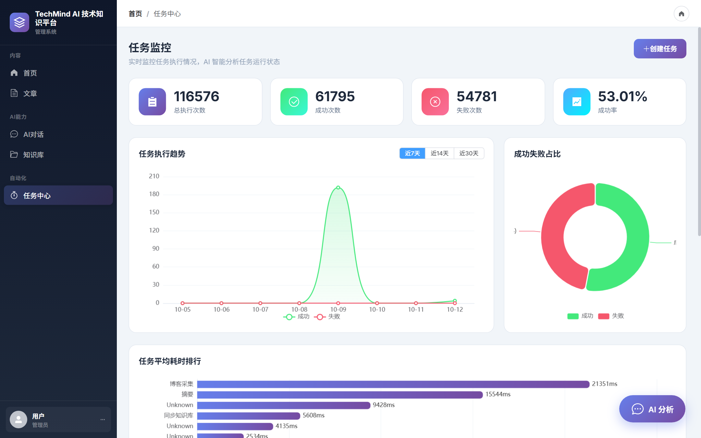
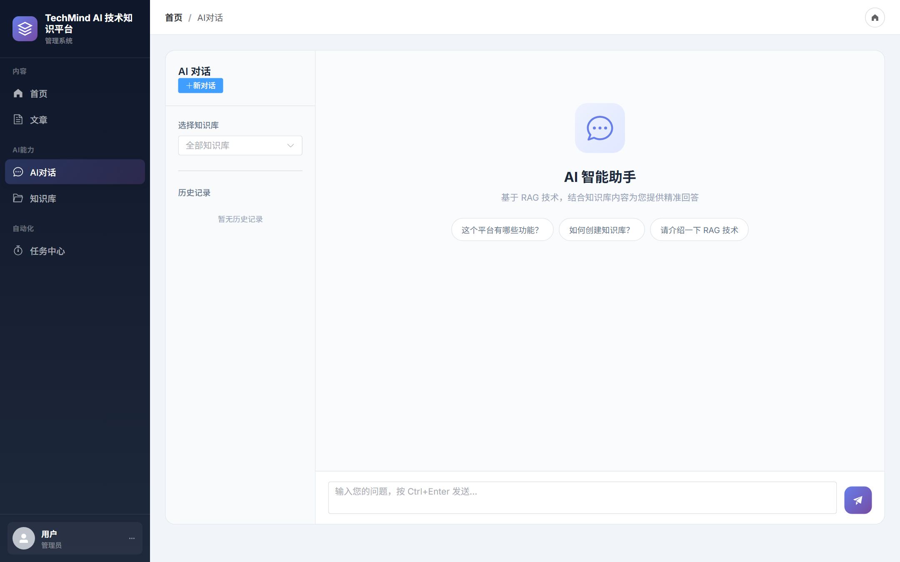
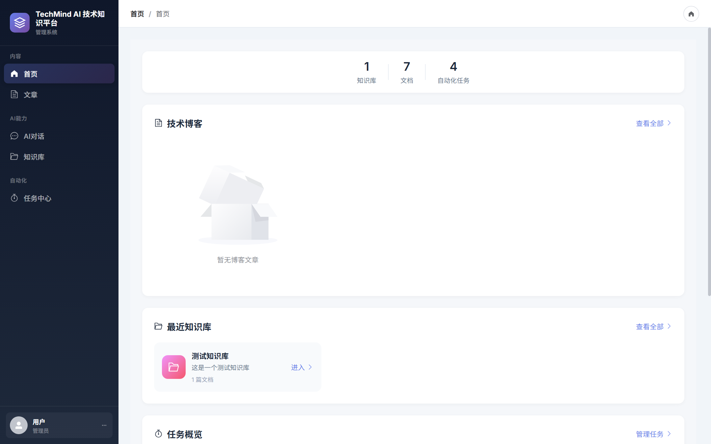
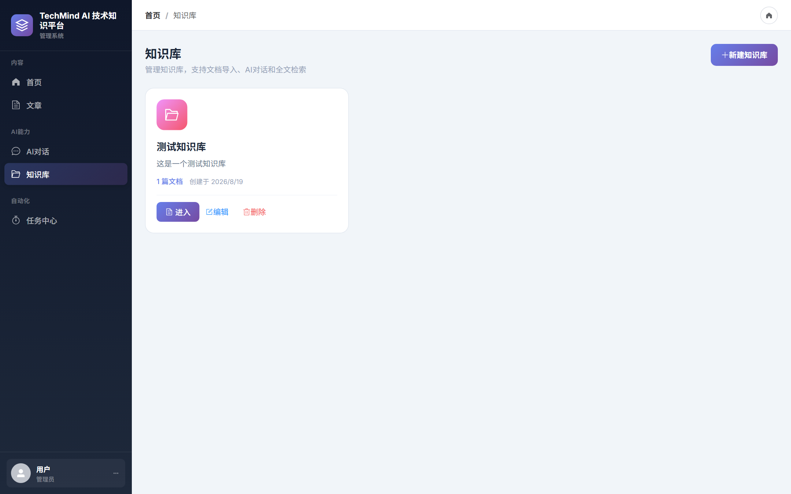
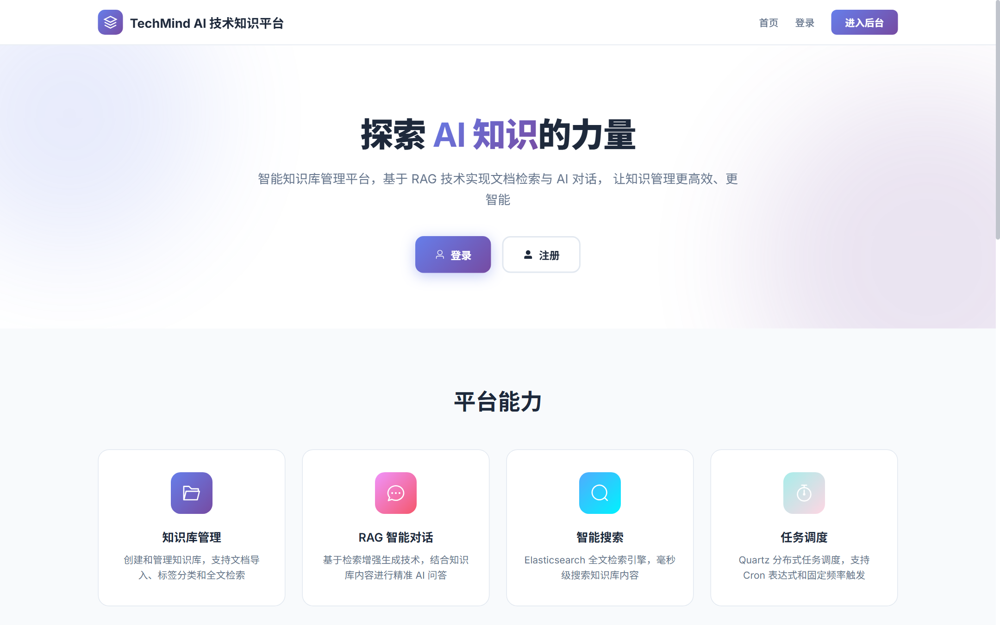
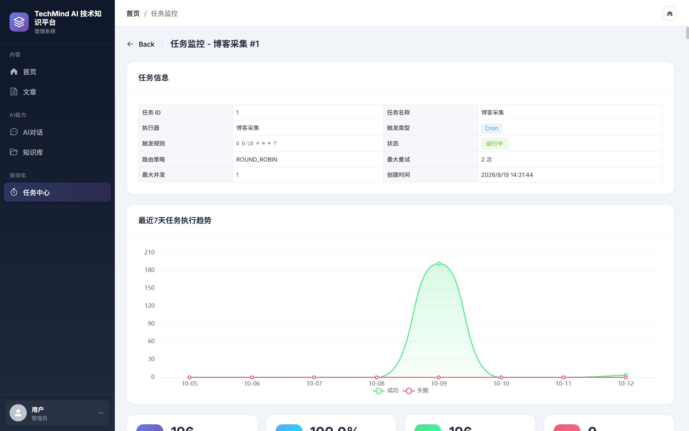
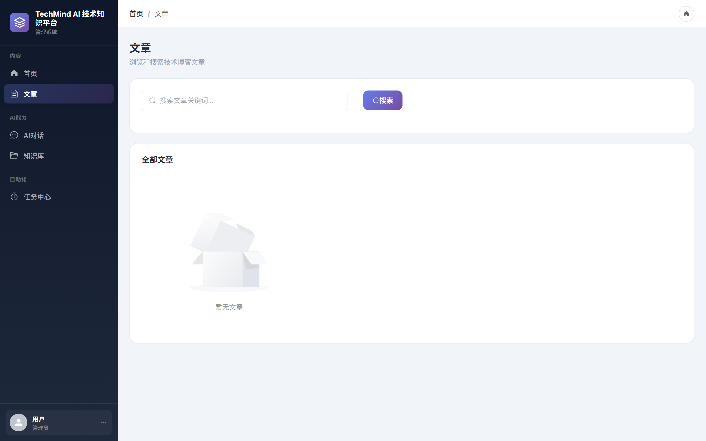

# TechMind · AI 技术知识平台

> 基于微服务架构的 AI 知识管理系统 —— **RAG 检索增强** · **Agent 工具调用** · **分布式任务调度**




---

## 项目简介

面向企业知识管理场景的 AI 平台：把散落的文档（技术博客、GitHub 仓库、PDF / Word）自动采集、解析、切片、向量化，
构建成可检索的知识库，再通过 **RAG + Agent** 提供智能问答与任务运行分析。

整个系统由三个后端服务 + 一个前端组成：

| 模块 | 端口 | 职责 |
| --- | --- | --- |
| `ai-auth-service` | 8082 | JWT 认证、RBAC 权限、用户管理 |
| `ai-service` | 8083 | **AI 核心**：RAG 检索、Agent 工具调用、评测体系、Text2SQL |
| `scheduler-service` | 8084 | 分布式任务调度：Quartz + 执行器路由 + 容错 |
| `ai-frontend` | 5173 | Vue3 管理后台 |

---

## 界面预览

### 任务监控
> 11.6 万条真实任务日志，支持趋势、成功率、耗时排行等多维分析


### AI 对话
> 基于 RAG 的智能问答，支持多轮会话、知识库范围选择与流式输出



### 工作台与知识库管理

| 工作台 | 知识库 |
| --- | --- |
|  |  |

### 平台首页



### 任务日志与文章管理

| 任务日志 | 文章 |
| --- | --- |
|  |  |

---

## 系统架构

```
┌──────────────┐
│  ai-frontend │   Vue3 + Element Plus + ECharts   (:5173)
└──────┬───────┘
       │ REST / SSE
┌──────▼──────────────────┐        ┌──────────────────┐
│      ai-service         │───────▶│  Elasticsearch   │  BM25 + kNN 双路召回
│  RAG · Agent · 评测     │        └──────────────────┘
│  Text2SQL     (:8083)   │───────▶ DeepSeek / DashScope
└───┬──────────────┬──────┘        （LLM · Embedding · Rerank）
    │              │
    │              └──────────────▶ Redis（会话历史 / 缓存）
    │
┌───▼─────────────────┐        ┌──────────────────────┐
│  scheduler-service  │◀──────▶│  ZooKeeper / RabbitMQ │
│  Quartz    (:8084)  │        └──────────────────────┘
└───┬─────────────────┘
    │
┌───▼──────┐    ┌───────┐
│  MySQL   │    │ Nacos │  服务注册与配置中心
└──────────┘    └───────┘
```

---

## 核心能力

### 1. RAG 检索增强

采用「双路召回 → RRF 融合 → 精排」的检索链路：

| 阶段 | 实现 |
| --- | --- |
| 关键词召回 | Elasticsearch `multiMatch`（content / title / tags） |
| 向量召回 | `text-embedding-v3`（1024 维）kNN 检索 |
| 融合 | RRF（Reciprocal Rank Fusion，k = 60） |
| 精排 | `gte-rerank-v2` 对候选集重排 |
| 生成 | DeepSeek-V3，WebClient + SSE 逐 Token 流式返回 |

**降级策略**：Embedding 服务不可用时显式跳过向量召回、降级为纯 BM25，
而不是用伪向量兜底（那会静默污染 kNN 结果）。

### 2. Agent 工具调用

基于 ReAct 模式实现的工具调用循环（`ToolCallLoop`），按 OpenAI 兼容协议组织消息：

```
system → user → assistant(tool_calls) → tool(tool_call_id) → ... → assistant(final)
```

已实现的关键机制：

- **标准工具协议**：工具结果以 `role=tool` + `tool_call_id` 回填，助手 `tool_calls` 进入历史，保证多轮上下文可追溯
- **轮次预算收敛**：工具调用轮次超限时移除工具并强制模型基于已有观测给出结论，而不是直接返回「已达最大次数」
- **上下文压缩**：消息总量超预算时，从最旧的工具结果开始做头尾保留式压缩，最新结果与 system / user 消息不动
- **多轮会话记忆**：从 Redis 载入该 `conversationId` 的最近若干轮对话，作为标准消息注入上下文
- **工具白名单**：按 Agent 职责裁剪可用工具，任务分析 5 个、文章摘要 4 个

当前共封装 **9 个工具**：任务统计、执行趋势、失败任务、耗时统计、任务日志、文章检索、知识查询、摘要生成、标签提取。

### 3. 评测体系

项目包含两套独立评测，且都保留原始结果文件：

**RAG 检索与生成质量**

| 项目 | 内容 |
| --- | --- |
| 测试集 | `rag-test-cases.json` —— **100 条**分层用例（按题型与难度） |
| 消融实验 | BM25 / 纯 kNN / 混合 RRF 三组对比 |
| 生成质量 | LLM-as-judge 评估 **40 条**用例：Faithfulness **0.9875**、Accuracy **0.9488** |
| BadCase | 输出 **10 条**归因清单用于迭代 |

**Agent 表现**（`AgentEvaluationService`）

12 条多类型任务用例（统计 / 趋势 / 失败诊断 / 性能 / 日志 / 多步诊断 / 综合），输出五个维度指标：

| 指标 | 含义 |
| --- | --- |
| 工具召回率 | 该调用的工具是否都调了 |
| 工具精确率 | 是否调用了无关工具 |
| 无效调用率 | 调用工具中不在期望集合的比例 |
| 平均步数 | 是否在轮次预算内收敛 |
| 答案关键词命中率 | 最终回答是否覆盖必要结论要素 |

> 评测直接复用线上同一套 `JobAnalysisAgent.runOnce()`（相同系统提示词、工具白名单与轮次预算），
> 避免出现「评测链路与线上不一致」导致分数失真。

### 4. 分布式任务调度

- **执行器路由**：轮询 / 随机 / 最小活跃 / 一致性哈希 / 广播，共 5 种策略
- **分布式防重**：Redisson 分布式锁（显式租约 + 持有者校验）配合 ZooKeeper Leader 选举，保证多实例下任务不重复执行
- **任务类型**：博客采集、GitHub 同步、PDF / Word 解析、文本切片、AI 摘要生成
- **容错**：失败重试、异步执行（`@Async` + `CompletableFuture`）、大文件解析的三重限制（页数 / 大小 / 超时）
- **交付**：Docker Compose 一键编排（5 个服务 + Nacos / Redis / RabbitMQ / Elasticsearch / ZooKeeper）

### 5. Text2SQL

自然语言转 SQL 并安全执行：

- 基于 **JSqlParser 的 AST 校验**：限单条语句、根节点必须为 `Select`，并拦截危险函数与文件写入
- 相比关键字黑名单，AST 方案不会误杀 `create_time`、`delete_flag` 这类**列名**
- 补全执行链路，并限制 `maxRows` 与 `queryTimeout`；低置信度查询按阈值拦截

---

## 技术栈

**后端**

| 类别 | 选型 |
| --- | --- |
| 框架 | Spring Boot 3.2、Spring Cloud Alibaba、Spring WebFlux |
| 注册与配置 | Nacos |
| 数据层 | MyBatis-Plus、Druid、MySQL 8 |
| 检索 | Elasticsearch 8.13（Java Client，kNN + 全文检索） |
| 缓存与锁 | Redis、Redisson |
| 消息 | RabbitMQ |
| 调度 | Quartz、ZooKeeper（Curator） |
| 容错 | Resilience4j |
| 安全 | Spring Security + JWT、JSqlParser |

**前端**：Vue 3、Vite 5、Element Plus、ECharts、Axios、Pinia

**AI**：DeepSeek-V3（对话）、text-embedding-v3（1024 维向量）、gte-rerank-v2（精排）

---

## 快速开始

### 环境要求

- JDK 17+、Maven 3.8+、Node.js 18+
- MySQL 8、Redis、RabbitMQ、Elasticsearch 8、ZooKeeper、Nacos
- 一个可用的 LLM / Embedding / Rerank API Key（阿里云百炼 DashScope 兼容模式）

### 1. 初始化数据库

```bash
mysql -u root -p < ai-platform/deploy/sql/nacos-schema.sql
mysql -u root -p < ai-platform/deploy/sql/init.sql
mysql -u root -p < ai-platform/deploy/sql/ai-schema.sql
mysql -u root -p < ai-platform/deploy/sql/auth-schema.sql
mysql -u root -p < ai-platform/deploy/sql/task-scheduler-schema.sql
```

### 2. 启动基础设施

```bash
cd ai-platform/deploy
docker compose up -d rabbitmq redis elasticsearch zookeeper nacos
```

### 3. 启动后端服务

```bash
cd ai-platform
mvn -DskipTests package

java -jar ai-auth-service/target/ai-auth-service-1.0.0-SNAPSHOT.jar
java -jar ai-service/target/ai-service-1.0.0-SNAPSHOT.jar
java -jar scheduler-parent/scheduler-service/target/scheduler-service-1.0.0-SNAPSHOT.jar
```

### 4. 启动前端

```bash
cd ai-platform/ai-frontend
npm install
npm run dev
```

访问 http://localhost:5173

---

## 效果数据

以下数据均为实测结果，原始文件保留在仓库中：

| 指标 | 结果 | 数据来源 |
| --- | --- | --- |
| 非流式全链路 P95 延迟 | 6.18s | `ai-platform/performance_test_result.json` |
| 流式首 Token 延迟（TTFT P95） | 1.19s | `ai-platform/sse_performance_result.json` |
| 单次问答成本 | ¥0.0009 | `ai-platform/performance_test_result.json` |
| 生成质量 Faithfulness / Accuracy | 0.9875 / 0.9488 | `ai-platform/llm_judge_results.json` |
| 任务日志单表规模 | 11.6 万行 | MySQL `task_scheduler.job_log` |
| 联合索引优化效果 | 104ms → 0.2ms | `EXPLAIN ANALYZE` |

---

## 项目结构

```
.
├── ai-platform/
│   ├── ai-auth-service/          认证与权限服务
│   ├── ai-service/               AI 核心：RAG / Agent / 评测 / Text2SQL
│   ├── ai-common/                公共组件
│   ├── ai-pojo/                  数据对象
│   ├── scheduler-parent/
│   │   ├── scheduler-service/    调度服务
│   │   └── task-scheduler-common/
│   ├── ai-frontend/              Vue3 前端
│   ├── deploy/                   SQL 脚本 / Docker 编排
│   └── jmeter/                   压测脚本与评测数据
├── docs/images/                  截图
└── schema.sql
```

---

## License

MIT